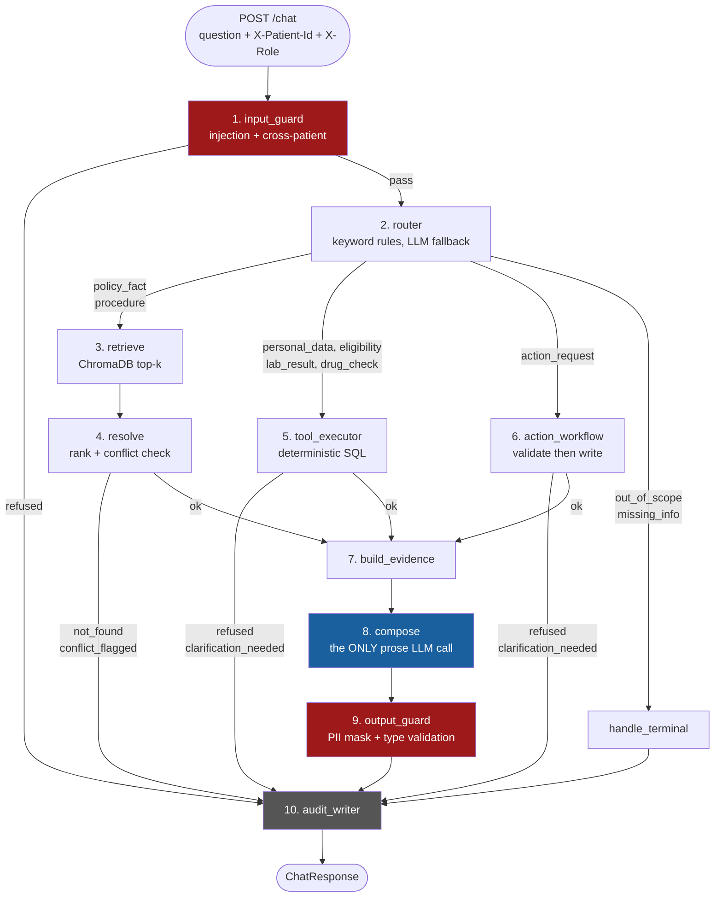

# AI-Powered Hospital Patient Services Assistant

A grounded question-answering assistant for hospital patients. It answers policy questions from
approved documents, reads a patient's own records through deterministic SQL tools, performs one
authorised action (rescheduling an appointment), refuses what it must refuse, and writes an audit
trace for every single request.

**The core design rule: the language model never computes and never decides.** It classifies intent
when keyword rules cannot, and it turns a tool-built evidence packet into readable English. Every
number, date, verdict and eligibility decision in an answer comes out of Python or SQL. If the
evidence packet is empty, the system says so rather than guessing.

---

## Contents

1. [Quick start](#1-quick-start)
2. [Troubleshooting](#2-troubleshooting--read-this-before-you-debug)
3. [What the system does](#3-what-the-system-does)
4. [Architecture: the graph](#4-architecture-the-graph)
5. [A request, end to end](#5-a-request-end-to-end)
6. [Repository map: why each file exists](#6-repository-map-why-each-file-exists)
7. [Function reference, file by file](#7-function-reference-file-by-file)
8. [Design decisions and what we rejected](#8-design-decisions-and-what-we-rejected)
9. [Requirement coverage R1–R11](#9-requirement-coverage-r1r11)
10. [Data model](#10-data-model)
11. [Known gaps — say these out loud, do not hide them](#11-known-gaps--say-these-out-loud-do-not-hide-them)
12. [Who explains what](#12-who-explains-what)

---

## 1. Quick start

**This project runs on Python 3.14.** Check first — the wrong interpreter is the single most common
failure, because `uvicorn.exe` is installed against 3.13 on this machine and its launcher is broken:

```
python --version          # must print 3.14.x
```

### Terminal 1 — the API

```
cd D:\Hackathonproject
python -m uvicorn app.api.main:app --port 8005 --host 127.0.0.1
```

Wait for `Application startup complete.` Then confirm:

```
curl http://localhost:8005/health
# {"status":"ok","sqlite":"ok","chromadb":"ok","llm_mock":false}
```

`llm_mock:false` means it is calling a real model. `true` means it is returning canned responses.

### Terminal 2 — the UI

```
cd D:\Hackathonproject
python -m streamlit run ui/streamlit_app.py
```

Opens on <http://localhost:8501>. The UI defaults to the API on port 8005; override with
`API_BASE_URL` if you move the API.

### First-time setup only

```
pip install -r requirements.txt
python scripts/seed_db.py      # builds data/hospital.db: 8 tables, ~20 rows each
python scripts/seed_docs.py    # builds data/chroma: 8 policy documents, 21 chunks
```

### Tests

All tests run fully offline — no API key, no network, no model:

```
set MOCK_LLM=true
set EMBEDDINGS=hash
python -m pytest -q
# 54 passed, 5 skipped
```

The 5 skips are bootstrap templates for a multi-agent architecture we deliberately did not build
(see [D8](#8-design-decisions-and-what-we-rejected)). They are skipped at module level, not failing.

---

## 2. Troubleshooting — read this before you debug

These are the failures we actually hit. Each one cost us time; none of them is your code being wrong.

| Symptom | Cause | Fix |
|---|---|---|
| `Fatal error in launcher: Unable to create process using '...Python313\uvicorn.exe'` | The `uvicorn` shim points at Python 3.13; the project's packages are in 3.14 | Always use `python -m uvicorn`, never bare `uvicorn` |
| `[Errno 10048] only one usage of each socket address` | An old server is still holding the port | Use a different port, or end the stray `python.exe` in Task Manager |
| UI shows "API unreachable" | Streamlit is pointed at the wrong port | API must be on 8005, or set `API_BASE_URL` |
| Every answer is "An internal error occurred" | The graph raised. The API deliberately converts any exception into a valid `refused` response rather than a bare 500 | Read Terminal 1 — the `[GATEWAY]` / `[NODE:]` prints show exactly which node failed |
| `Error code: 404 ... model 'llama-3.3-70b-versatile' does not exist` | Our Groq key has no Llama access | Already handled: the gateway auto-falls-back through `openai/gpt-oss-20b`, `qwen/qwen3.8-27b`, `openai/gpt-oss-120b` |
| Gemini 404 telling you to use `models/gemini-3.8-flash` | `gemini-2.0-flash` was withdrawn | Already handled: `_GEMINI_MODEL_ALIASES` rewrites old names to `gemini-3.8-flash` |
| Retrieval returns the wrong documents for everything | `data/chroma` holds chunks embedded with a *different* embedding function, or junk from an earlier `/admin/ingest` test | Delete `data/chroma`, re-run `python scripts/seed_docs.py`, restart the API |
| `UnicodeEncodeError: 'charmap'` on a debug print | Windows console is cp1252; the model returned a typographic character like `\u202f` | Cosmetic, affects the log line only. Keep seed scripts ASCII (`[OK]`, not `✓`) |

**Why every node prints.** Each node writes a `[NODE:<name>]` line to stdout with its inputs and its
decision. That is how you debug this system: you do not need a breakpoint, you read Terminal 1 and
watch the request walk the graph. The prints are the reason a failure is never a mystery.

### Environment

`.env` is gitignored and holds only these keys. `.env.example` lists the names with no values.

| Variable | Meaning |
|---|---|
| `GROQ_API_KEY` | Primary provider |
| `GROQ_MODEL` | Requested model; the gateway falls back if the key lacks access |
| `GEMINI_API_KEY` | Fallback provider |
| `GEMINI_MODEL` | `gemini-3.8-flash` |
| `MOCK_LLM` | `true` → no network, canned responses. Every test sets this |
| `EMBEDDINGS` | `hash` → deterministic fake embeddings for tests. Empty → real MiniLM |

**SDK versions matter.** We use `groq>=1.7` and `google-genai>=2.33`. The latter is the *new* Google
SDK (`from google import genai`, `genai.Client(...)`), not the retired `google-generativeai`
(`genai.GenerativeModel(...)`). If you find a tutorial using `GenerativeModel`, it is out of date.

---

## 3. What the system does

Seven and only seven kinds of answer can leave the API. The set is closed and validated in code —
`output_guard` rejects anything else and downgrades it to `not_found`.

| `answer_type` | Means | Produced when |
|---|---|---|
| `retrieved_fact` | Supported directly by an approved document | A policy question found matching chunks |
| `calculated` | Produced by a deterministic tool | A SQL tool returned rows |
| `action_completed` | An authorised workflow ran | A reschedule passed every validation and the DB was updated |
| `clarification_needed` | Required information is missing | A reschedule with no date, for instance |
| `not_found` | Authorised sources do not contain the answer | Retrieval came back empty |
| `refused` | Unauthorised or unsafe | Prompt injection, or asking about another patient |
| `conflict_flagged` | Two policies conflict and cannot be ordered | Authority, version and date all tie |

The not-found wording is fixed and quoted verbatim from the problem statement in one place
([`app/api/schemas.py:27`](app/api/schemas.py#L27)):

```python
NOT_FOUND_MSG = "I could not find this information in the authorised hospital sources."
```

### The four endpoints

| Endpoint | Purpose |
|---|---|
| `POST /chat` | Ask a question. Requires `X-Patient-Id`; `X-Role` defaults to `patient` |
| `POST /admin/ingest` | Upload a new policy document. Requires `X-Role: admin`. Takes effect immediately, no restart |
| `GET /trace/{trace_id}` | Retrieve the audit record for one request |
| `GET /health` | Readiness of SQLite, ChromaDB, and whether the LLM is mocked |

---

## 4. Architecture: the graph

One LangGraph `StateGraph`. Ten nodes, fixed wiring, no loops, no planner, no agent that chooses its
own tools. Control flow is five small pure functions reading one field of state. You can hold the
whole thing in your head, which is the point.



<details>
<summary><b>Same graph in plain text</b> (for a terminal, a projector that won't render Mermaid, or a PDF)</summary>

```
request (question + X-Patient-Id + X-Role)
   |
   v
[1] input_guard ----- injection? other patient's ID? ----> refused ----+
   | pass                                                              |
   v                                                                   |
[2] router   (keyword rules first; LLM only when no rule matches)       |
   |                                                                   |
   +-- policy_fact, procedure -----> [3] retrieve --> [4] resolve --+   |
   |                                                    | not_found |   |
   |                                                    | conflict -+---+
   +-- personal_data, eligibility,                      | ok        |   |
   |   lab_result, drug_check ------> [5] tool_executor -+           |   |
   |                                                    | refused   |   |
   |                                                    | clarify --+---+
   +-- action_request --------------> [6] action_workflow+           |   |
   |                                                    | ok        |   |
   +-- out_of_scope, missing_info --> handle_terminal ---------------+---+
                                                        |           |   |
                                                        v           |   |
                                         [7] build_evidence <-------+   |
                                                        |               |
                                                        v               |
                                         [8] compose   <-- the only node|
                                                        |   that writes |
                                                        |   prose       |
                                                        v               |
                                         [9] output_guard                |
                                              (PII mask, type validate) |
                                                        |               |
                                                        v               |
                                        [10] audit_writer <-------------+
                                                        |
                                                        v
                                                   ChatResponse
```
</details>

### Why the shape is what it is

**One LLM call on the common path.** `compose` always runs; `router` calls the model only when no
keyword rule matched. So a routed question costs one model call, and an unrouted one costs two.

**Three paths, chosen once.** Knowledge questions go to retrieval. Questions about the patient's own
data go to a SQL tool. The one mutating request goes to a workflow that validates before it writes.
A question takes exactly one path; there is no step where the system loops back and tries something
else.

**Guards at both ends, audit on every exit.** Every route — including every refusal and every early
exit — passes through `audit_writer`. There is no way to return a response without writing a trace,
because the graph has no edge to `END` that skips it.

The entire routing logic ([`app/graph/build.py:59`](app/graph/build.py#L59)):

```python
def _after_router(state: State) -> str:
    intent = state.get("intent", "")
    if intent in (INTENT_MISSING_INFO, INTENT_OUT_OF_SCOPE):
        return "handle_terminal"
    if intent in (INTENT_POLICY_FACT, INTENT_PROCEDURE):
        return "retrieve"
    if intent in (INTENT_PERSONAL_DATA, INTENT_ELIGIBILITY, INTENT_LAB_RESULT, INTENT_DRUG_CHECK):
        return "tool_executor"
    if intent == INTENT_ACTION:
        return "action_workflow"
    return "handle_terminal"
```

If a judge asks "what happens to an intent you didn't anticipate?" — the last line. It terminates
politely rather than falling through to an LLM.

### State

Nodes never talk to each other. Each one receives the whole state and returns a dict of only the
fields it changed; LangGraph merges them. That is why a node can be unit-tested with a plain dict
and no graph at all ([`app/graph/state.py`](app/graph/state.py)):

```python
class State(TypedDict, total=False):
    trace_id: str          # unique HSP-XXXXXXXX identifier for this request
    patient_id: str        # from X-Patient-Id header; NEVER from question text
    role: str              # "patient" or "admin" from X-Role header
    question: str
    intent: str
    params: dict[str, Any]
    chunks: list[dict[str, Any]]        # retrieved policy chunks
    tool_results: list[dict[str, Any]]  # deterministic SQL tool output
    evidence: dict[str, Any]            # merged packet handed to compose
    answer: str
    answer_type: str
    citations: list[dict[str, Any]]
    tools_invoked: list[dict[str, Any]]
    explanation: str
    assumptions: list[str]
    audit: dict[str, Any]
    start_time: float      # time.monotonic() at entry, for latency
```

The comment on `patient_id` is the whole of R7. Identity is written into state once, by the endpoint,
from a header. No node ever reads an identity out of the question text.

---

## 5. A request, end to end

Trace a real one: **"What are my upcoming appointments?"** as patient `P1001`.

**The endpoint** ([`app/api/main.py:66`](app/api/main.py#L66)) mints a trace ID, builds the initial
state, and invokes the graph. Note where identity comes from — a header, declared as required:

```python
async def chat(
    body: ChatRequest,
    x_patient_id: str = Header(..., alias="X-Patient-Id"),
    x_role: str = Header(default="patient", alias="X-Role"),
) -> ChatResponse:
    trace_id = f"HSP-{uuid.uuid4().hex[:8].upper()}"
    initial_state = {"trace_id": trace_id, "patient_id": x_patient_id, "role": x_role,
                     "question": body.question, "start_time": time.monotonic(), ...}
```

The whole invocation is wrapped in `try/except`. Any unhandled exception becomes a valid
`refused` ChatResponse, never a bare HTTP 500 — which is why a crash shows up in the UI as
"An internal error occurred" and why you must read Terminal 1 to find the real cause.

Then, node by node, as the console shows it:

```
[NODE:input_guard] trace=HSP-76079B2A | patient=P1001 | question='What are my upcoming appointments?'
[NODE:input_guard] PASSED — safe to continue
```
**1. input_guard.** Two deterministic regex checks, before any model call and before any database
read. `is_injection` looks for "ignore previous instructions", `act as`, `<system>` tags and friends.
`extract_other_patient_ids` finds any `P####` that is not the caller's, plus indirect references
("her results", "my daughter's labs"). Either one short-circuits straight to `audit_writer` with
`refused`.

```
[NODE:router] Classifying: 'What are my upcoming appointments?'
[NODE:router] Keyword intent: 'personal_data'
[NODE:router] Using keyword intent=personal_data | params={...}
```
**2. router.** `classify_intent` tried ordered regex rules and matched `my appointments?` →
`personal_data`. **No LLM call happened.** Every one of the eight demo questions resolves here, which
is why routing is fast, deterministic, and correct even with `MOCK_LLM=true`. (We have not measured
the keyword hit rate across the full eval set — see
[Known gaps](#11-known-gaps--say-these-out-loud-do-not-hide-them).)

```
[NODE:tool_executor] intent=personal_data → tool=get_appointments
[NODE:tool_executor] Calling get_appointments(patient_id=P1001)
[NODE:tool_executor] Result: 2 appointment(s)
```
**5. tool_executor.** Dispatches intent → tool through a dict, and calls it with `patient_id` taken
**from state, not from the question**. `get_appointments` runs parameterised SQL scoped to that one
patient. Note what the trace records: `params: {"patient_id": "[redacted]"}` — the audit proves which
tool ran without storing the identifier.

```
[NODE:build_evidence] 0 chunk(s), 1 tool result(s)
```
**7. build_evidence.** Merges retrieved chunks and tool results into one dict. This is the *only*
thing `compose` is allowed to see. If it is empty, the answer is `not_found` — the LLM is never given
the chance to fill a gap from its own training.

```
[GATEWAY] call_llm | mode=compose | mock=False | msg_len=...
[GROQ] Trying model=openai/gpt-oss-20b
[GROQ] OK | model=openai/gpt-oss-20b | tokens=615
[GATEWAY] Done | model=openai/gpt-oss-20b | latency=1284ms
```
**8. compose.** The only node that produces prose. It receives the evidence packet and a system
prompt that forbids inventing anything. It picks no tools and computes no values — both rows were
already fetched and the "which one is upcoming" judgement is visible in its explanation, checkable
against the data.

```
[NODE:output_guard] answer_type='calculated' | answer_preview='Your upcoming appointment is:...'
[NODE:output_guard] PASSED — returning answer_type=calculated
[NODE:audit_writer] trace=HSP-76079B2A | answer_type=calculated | tools='get_appointments' | latency=1402ms
[NODE:audit_writer] Audit written OK
```
**9. output_guard.** Validates `answer_type` against the closed set of seven, then masks PII
patterns (10-digit phones, ISO dates, policy IDs) out of the prose. **10. audit_writer.** Writes the
row to `audit_log` with latency, tools, answer type and a redacted question.

The response the client received:

```json
{
  "trace_id": "HSP-76079B2A",
  "answer": "Your upcoming appointment is:\n- **Cardiology** with **Dr. Smith** on **November 5, 2026 at 10:00 AM**.\n\nThe other appointment (Radiology with Dr. Patel on October 20, 2026) has already been completed.",
  "answer_type": "calculated",
  "citations": [{"system": "Hospital Information System"}],
  "tools_invoked": [{"tool": "get_appointments", "params": {"patient_id": "[redacted]"},
                     "result_summary": "{'patient_id': 'P1001', 'appointments': [...]}"}],
  "explanation": "The evidence packet lists two appointments. Appointment A002 is marked 'Completed', so it is not upcoming. Appointment A001 is marked 'Scheduled' and its date is in the future, so it is the only upcoming appointment.",
  "assumptions": []
}
```

The `explanation` field is doing real work for us: it is a plain-language audit of the reasoning that
a judge can check against the two database rows in `tools_invoked`.

---

## 6. Repository map: why each file exists

```
app/api/        the HTTP boundary — contract, endpoints
app/graph/      orchestration — state, nodes, wiring, routing rules
app/tools/      deterministic SQL tools (where all the real answers come from)
app/rag/        document indexing and search
app/llm/        the single LLM gateway
app/trace/      audit persistence
ui/             Streamlit client
scripts/        data seeding
eval/           evaluation harness and cases
tests/          54 offline tests
data/           runtime stores (gitignored)
docs/           statement, requirements, architecture, decisions
```

### Files that are live in this build

| File | Why it exists |
|---|---|
| [app/api/main.py](app/api/main.py) | The four endpoints. Reads identity from headers, mints the trace ID, invokes the graph, converts exceptions into valid refusals |
| [app/api/schemas.py](app/api/schemas.py) | The contract as Pydantic v2 models, plus the closed `ANSWER_TYPES` set and the verbatim not-found string. Changing the API shape means changing this file and nothing else |
| [app/graph/state.py](app/graph/state.py) | The one `State` TypedDict every node reads and writes |
| [app/graph/policy.py](app/graph/policy.py) | All problem-specific rules in one file: keyword routing patterns, injection patterns, cross-patient patterns, authority ranking. **This is the file to edit when a judge asks for a behaviour change** |
| [app/graph/nodes.py](app/graph/nodes.py) | The ten node functions and the two LLM prompts |
| [app/graph/build.py](app/graph/build.py) | Graph wiring: registers nodes, declares edges, holds the five routing functions. Compiled once at import into `hospital_graph` |
| [app/tools/hospital.py](app/tools/hospital.py) | The five deterministic tools. Pure functions, typed in and out, parameterised SQL, every one scoped to a single patient |
| [app/rag/index.py](app/rag/index.py) | ChromaDB client, collection, the dual embedding function (real MiniLM / deterministic hash for tests), add and search |
| [app/rag/ingest_docs.py](app/rag/ingest_docs.py) | Parses PDF/MD/TXT, splits into overlapping chunks, writes them with metadata. Shared by the seed script and the live `/admin/ingest` endpoint — the demo path and the setup path are the same code |
| [app/llm/gateway.py](app/llm/gateway.py) | The only place in the codebase that talks to a model. Groq → Gemini chain, model fallback, JSON repair, mock mode |
| [app/trace/store.py](app/trace/store.py) | Writes and reads the `audit_log` table, with ownership enforced on read |
| [ui/streamlit_app.py](ui/streamlit_app.py) | Two tabs: patient chat with answer-type badges, citations and tool traces; admin document upload |
| [scripts/seed_db.py](scripts/seed_db.py) | Creates the 8 tables and seeds ~20 rows each, including the deliberate edge cases |
| [scripts/seed_docs.py](scripts/seed_docs.py) | Seeds the 8 policy documents, including a superseded version and a deliberate tie-conflict pair |
| [eval/run_eval.py](eval/run_eval.py) | Runs `cases.yaml` against the API or in-process and reports accuracy, citation rate, abstention and latency percentiles |
| [eval/cases.yaml](eval/cases.yaml) | 25 evaluation cases spanning all seven answer types and the edge cases |

### Files installed by the bootstrap kit that this build does *not* use

Be straight about these in a viva — "it is scaffolding we chose not to use" is a much better answer
than being caught unsure what a file does.

| File | Status |
|---|---|
| `app/graph/supervisor.py` | A multi-agent supervisor. Not wired — see [D8](#8-design-decisions-and-what-we-rejected) |
| `app/api/service.py` | Generic graph→response adapter for the supervisor architecture. `main.py` invokes the graph directly instead. Still imported by the eval harness's in-process mode |
| `app/analytics/*.py` | Seven modules for quantitative problems (baselines, bridges, anomalies, savings). Wrong problem archetype; unused |
| `app/tools/registry.py`, `catalog.py`, `search.py`, `example_orders.py` | A dynamic tool-registry pattern. We dispatch through an explicit dict in `tool_executor`, which is simpler and greppable |
| `app/data/*.py` | Generic loader, validator, rule registry. Our schema is fixed and seeded by script |
| `app/llm/guard.py` | A numeric faithfulness checker. **Written but not wired into the graph** — see [Known gaps](#11-known-gaps--say-these-out-loud-do-not-hide-them) |

---

## 7. Function reference, file by file

Every function, in execution order where that makes sense. A leading underscore means module-private.

### app/api/main.py — the HTTP boundary

| Function | Signature | What it does |
|---|---|---|
| `chat` | `(ChatRequest, X-Patient-Id, X-Role) -> ChatResponse` | Mints `HSP-xxxxxxxx`, builds initial state from headers, invokes the graph, maps the final state to the response. Catches every exception and returns a valid `refused` rather than a 500 |
| `admin_ingest` | `(UploadFile, authority, version, effective_date, section, X-Role) -> IngestResponse` | Rejects non-admin roles, saves the upload to a temp file, calls `ingest_document`, deletes the temp file in a `finally` |
| `get_trace` | `(trace_id, X-Patient-Id) -> dict` | Returns one audit record; 404 if it does not exist **or** is not the caller's |
| `health` | `() -> HealthResponse` | Probes SQLite and ChromaDB and reports whether the LLM is mocked |

### app/api/schemas.py — the contract

| Symbol | What it is |
|---|---|
| `ANSWER_TYPES` | The closed set of seven valid answer types. `output_guard` validates against this |
| `NOT_FOUND_MSG` | The abstention sentence, verbatim from the statement, defined once |
| `ChatRequest` | `question: str`, `confirm: bool` |
| `IngestRequest` | Document metadata: authority, version, effective_date, section |
| `Citation` | `system`, `doc`, `section`, `version`, `effective_date` — all optional, because an operational-system citation has no document and vice versa |
| `ToolInvoked` | `tool`, `params` (identifier redacted), `result_summary` |
| `ChatResponse` | `trace_id`, `answer`, `answer_type`, `citations`, `tools_invoked`, `explanation`, `assumptions` |
| `HealthResponse` | `status`, `sqlite`, `chromadb`, `llm_mock` |
| `IngestResponse` | `status`, `doc_id`, `chunks_added`, `message` |

### app/graph/policy.py — all problem-specific rules

| Function / symbol | What it does |
|---|---|
| `_KEYWORD_RULES` | Ordered `(regex, intent)` list. First match wins, so specific patterns sit above broad ones — action requests first, bare "policy" near the bottom |
| `_INJECTION_PATTERNS` | Six regexes for prompt-injection attempts |
| `_OTHER_PATIENT_ID_PATTERN` | `\bP\d{4}\b` — any patient identifier in the text |
| `_OTHER_PATIENT_NAME_PATTERN` | Indirect third-party references: "her results", "my daughter's labs" |
| `AUTHORITY_RANK` | `government_regulation: 3 > clinical_guideline: 2 > hospital_policy: 1` |
| `classify_intent` | `(str) -> str \| None` — walks the rules in order; returns an intent, or `None` to tell the router to ask the LLM |
| `is_injection` | `(str) -> bool` — any injection pattern matches |
| `extract_other_patient_ids` | `(question, caller_id) -> list[str]` — every `P####` that is not the caller's, plus `'name_ref'` for indirect references |
| `authority_score` | `(chunk) -> tuple[int, str, str, str]` — the conflict-resolution sort key |

The two functions that carry the most design weight:

```python
def classify_intent(question: str) -> str | None:
    for pattern, intent in _KEYWORD_RULES:
        if pattern.search(question):
            return intent
    return None  # LLM fallback needed
```

`None` rather than a guess. The router treats it as "I don't know, ask the model" — the uncertainty is
explicit in the type, not buried in a default.

```python
def authority_score(chunk: dict) -> tuple[int, str, str, str]:
    rank = AUTHORITY_RANK.get(chunk.get("authority", "hospital_policy"), 0)
    return (rank, chunk.get("version", "0"),
            chunk.get("effective_date", "1900-01-01"),
            chunk.get("ingested_at", "1900-01-01T00:00:00"))
```

Python compares tuples left to right, so this single return value *is* the four-level precedence
policy: authority, then version, then effective date, then recency. `conflict_flagged` fires only
when two chunks produce equal tuples — genuinely unorderable, not merely disagreeing.

### app/graph/nodes.py — the ten nodes

| Function | Signature | What it does |
|---|---|---|
| `input_guard` | `(State) -> dict` | **R7, R8.** Injection check and cross-patient check, before any model or database access. Sets `refused` and short-circuits |
| `router` | `(State) -> dict` | Keyword rules first; calls the LLM only on no match. Returns `intent` + `params`. Skips entirely if already refused |
| `_extract_params_only` | `(str) -> dict` | Regex extraction of `appointment_id` (`A\d{3,}`), ISO date/time, procedure name and lab-test name from fixed vocabularies. Runs with no LLM, so parameters are extracted correctly in mock mode too |
| `retrieve` | `(State) -> dict` | ChromaDB top-k search over policy chunks |
| `resolve` | `(State) -> dict` | Sorts chunks by `authority_score`. Sets `not_found` on no chunks, or `conflict_flagged` when the top two chunks score *exactly* equal **and come from different documents** (two chunks of one document tying is not a conflict) |
| `_TOOL_DISPATCH` | dict | `personal_data→get_appointments`, `eligibility→check_insurance_eligibility`, `lab_result→get_lab_results`, `drug_check→drug_interaction_check` |
| `tool_executor` | `(State) -> dict` | **R5.** Looks up the tool, calls it with `patient_id` **from state**, records a `ToolInvoked` entry with the identifier redacted |
| `action_workflow` | `(State) -> dict` | **The only mutating path.** Needs `appointment_id` and `preferred_date` or returns `clarification_needed`. Delegates every check to `reschedule_appointment` and maps the outcome to `action_completed` or `refused` |
| `build_evidence` | `(State) -> dict` | Merges chunks and tool results into the single packet `compose` may see |
| `_COMPOSE_SYSTEM_PROMPT` | str | Instructs: answer only from evidence, cite sources, never invent, abstain when evidence is missing |
| `compose` | `(State) -> dict` | The one prose LLM call. Builds citations from the evidence and sets `answer_type` |
| `_format_evidence` | `(dict) -> str` | Renders the packet as readable text for the prompt |
| `_infer_answer_type` | `(intent, evidence) -> str` | Deterministic mapping from intent and evidence shape to answer type. The model does not choose its own answer type |
| `_PII_PATTERNS` | list | 10-digit phone numbers, ISO dates, policy identifiers |
| `output_guard` | `(State) -> dict` | **R2, R3, R7.** Downgrades a missing or invalid `answer_type` to `not_found`, then masks PII from the prose |
| `audit_writer` | `(State) -> dict` | **R10.** Computes latency from `start_time`, writes the audit row. Every path ends here |

### app/graph/build.py — the wiring

| Function | What it does |
|---|---|
| `_after_input_guard` | `refused` → `audit_writer`, else `router` |
| `_after_router` | Intent → one of `retrieve`, `tool_executor`, `action_workflow`, `handle_terminal` |
| `_after_resolve` | `not_found` or `conflict_flagged` → `audit_writer`, else `build_evidence` |
| `_after_tool_or_action` | `refused` or `clarification_needed` → `audit_writer`, else `build_evidence` |
| `_after_output_guard` | Always `audit_writer` |
| `handle_terminal` | Produces the terminal answer for `out_of_scope` and `missing_info` |
| `build_graph` | Registers the ten nodes, declares the edges, compiles |
| `hospital_graph` | Module-level singleton: the graph is compiled once at import, not per request |

### app/tools/hospital.py — the deterministic tools

Every one is a pure function with typed input and output. Every query is parameterised — no string
interpolation into SQL anywhere. Every patient query is scoped to one `patient_id`.

| Function | Signature | What it does |
|---|---|---|
| `_conn` | `() -> sqlite3.Connection` | Opens `data/hospital.db` with `row_factory` set so rows come back as dicts |
| `get_appointments` | `(patient_id) -> dict` | All appointments for that patient with doctor, department, datetime and status |
| `check_insurance_eligibility` | `(patient_id, procedure) -> dict` | Joins the patient's policy to the procedure's coverage. Returns the verdict plus the reason: expired policy, procedure not covered, no policy on file, or covered with its limits. **The decision is SQL and Python, never the model** |
| `get_lab_results` | `(patient_id, test_name=None) -> dict` | Lab results, optionally filtered to one test. Reports a pending result as pending rather than omitting it |
| `drug_interaction_check` | `(medication_list) -> dict` | Looks up each pair in `drug_interactions` and returns severity and guidance. The only tool that is not patient-scoped, because it asks about drugs, not a person |
| `reschedule_appointment` | `(patient_id, appointment_id, preferred_date) -> dict` | The one write. Checks in order: appointment exists, belongs to the caller, is still `Scheduled`, the new datetime is in the future, a matching doctor slot is free. Updates both tables on success; on failure returns the specific reason **and alternative slots** |
| `_get_available_slots` | `(doctor_name, limit=5) -> list[str]` | Free slots, so a refusal is useful instead of a dead end |

The refusal-with-alternatives shape is deliberate: a patient who picks an unavailable time gets told
which times *are* available, in the same response, with no second round trip.

### app/rag/index.py — the vector store

| Function | What it does |
|---|---|
| `_hash_embed` | `(str) -> list[float]` — deterministic pseudo-embedding from a hash. Makes retrieval reproducible offline with no model download |
| `_get_hash_ef` | Wraps `_hash_embed` in ChromaDB's `EmbeddingFunction[Documents]` interface |
| `_get_client` | The `PersistentClient` on `data/chroma` |
| `_get_collection` | Gets or creates `hospital_policies` with whichever embedding function the environment selects |
| `add_chunks` | Writes chunks with metadata: doc, section, version, effective_date, authority, status |
| `search_documents` | Top-k query returning text plus metadata, which is what becomes a citation. **Filters before ranking:** `where={"status": "active"}` and `effective_date <= today`. Returns `[]` on any ChromaDB error rather than raising |

**Superseded documents never enter the pipeline.** The filtering is here, in the vector query — not
in `resolve`. By the time chunks reach `resolve` they are already active and in effect, so `resolve`
only has to rank and detect ties. If a judge asks "what happens to the old ICU policy v1.0?", the
answer is that `status: "superseded"` excludes it at the ChromaDB `where` clause and it is never
retrieved, never ranked, and never cited.

`EMBEDDINGS=hash` swaps real MiniLM for the hash function. Tests get speed and determinism;
production gets semantic search. **The trap:** chunks embedded by one function are meaningless to the
other, so if you change this variable you must delete `data/chroma` and re-seed. This cost us an
afternoon of "why is every answer about the wrong document".

### app/rag/ingest_docs.py — document ingestion

| Function | What it does |
|---|---|
| `_parse_pdf` | Text per page via `pypdf` |
| `_parse_markdown` | Reads MD/TXT as text |
| `_split_into_chunks` | `(text, chunk_size=800, overlap=100)` — overlapping windows on paragraph boundaries, so a fact spanning a boundary survives in at least one chunk |
| `ingest_document` | Parse → chunk → attach metadata → `add_chunks`. Returns `doc_id` and the chunk count |

`/admin/ingest` and `seed_docs.py` both call `ingest_document`. The live demo path is the same code
as the setup path, so a judge uploading a PDF exercises exactly what we tested.

### app/llm/gateway.py — the only model caller

| Function / symbol | What it does |
|---|---|
| `_GEMINI_MODEL_ALIASES` | Rewrites withdrawn names (`gemini-2.0-flash`, `gemini-1.5-*`) to `gemini-3.8-flash` |
| `_GROQ_FALLBACK_MODELS` | `openai/gpt-oss-20b`, `qwen/qwen3.8-27b`, `openai/gpt-oss-120b` |
| `MOCK_RESPONSES` | Canned router and compose responses keyed by mode |
| `_is_mock` | Reads `MOCK_LLM` |
| `call_llm` | `(system_prompt, user_message, mode, schema, temperature) -> dict` — the single entry point. Mock short-circuit, then Groq, then Gemini, then raise. Attaches `_meta` with model and latency |
| `_call_groq` | Tries the requested model, then each fallback on a model-not-found error. Re-raises other errors immediately rather than burning the chain on, say, a bad key |
| `_call_gemini` | The new `google-genai` client with `response_mime_type="application/json"` |
| `_parse_json` | Strips markdown fences, then retries on the outermost `{...}`, then returns a `_parse_error` marker rather than raising |

The model fallback, which is why a dead model name does not take the demo down:

```python
for model in models_to_try:
    try:
        resp = client.chat.completions.create(model=model, messages=[...],
                                              response_format={"type": "json_object"})
        return resp.choices[0].message.content, model
    except Exception as e:
        last_err = e
        if "model" not in str(e).lower() and "404" not in str(e):
            raise          # a real error — fail fast, don't retry the chain
```

The discrimination in that `if` matters: a missing model should fall back, a bad API key should fail
immediately and loudly.

Because this is the only module that touches a provider, `MOCK_LLM=true` makes the entire system
offline-testable, and switching provider is a one-file change.

### app/trace/store.py — audit

| Function | What it does |
|---|---|
| `_conn` | Connection to `data/hospital.db` |
| `write_audit` | Inserts trace_id, patient_id, redacted question, answer_type, tools, model, latency, timestamp |
| `get_trace` | `(trace_id, requesting_patient_id)` — returns the record **only** if it belongs to the requester, else `None`. Ownership is enforced in the data layer, not only at the endpoint |

### ui/streamlit_app.py — the client

A thin client. It never computes; it renders what the API returned.

| Function / symbol | What it does |
|---|---|
| `API_BASE` | `API_BASE_URL` env var, default `http://localhost:8005` |
| `BADGE_COLOURS` | A colour per answer type, so the response's provenance is visible at a glance |
| `DEMO_QUESTIONS` | Eight one-click demo prompts covering the answer types |
| `PATIENTS` | Five selectable patients including the edge cases (expired policy, pending lab, no insurance) |
| `_badge` | Renders the coloured answer-type pill |
| `_call_chat` | `POST /chat` with identity headers; returns a valid shape even on a connection error |
| `_get_health` | `GET /health`; reports `unreachable` rather than throwing |
| `_ingest_doc` | `POST /admin/ingest` with `X-Role: admin` |

The patient picker is the honest demonstration of R7: switch identity in the sidebar and the same
question returns different data, because identity rides in a header and nothing else.

### scripts/ — seeding

| Function | What it does |
|---|---|
| `seed_db.create_tables` | The 8 tables |
| `seed_db.seed_patients` / `seed_appointments` / `seed_insurance` / `seed_lab_results` / `seed_drug_interactions` / `seed_doctor_slots` | ~20 rows each, including the deliberate edge cases |
| `seed_db.main` | Drops and rebuilds, so seeding is idempotent |
| `seed_docs.DOCUMENTS` | The 8 policy documents as inline text — no binary fixtures in the repo |
| `seed_docs.seed_all_documents` | Chunks and indexes all of them |
| `seed_docs._mark_superseded` | Marks the old ICU policy v1.0 superseded, so version resolution has something real to resolve |

### eval/run_eval.py — measurement

| Function | What it does |
|---|---|
| `get_path` | Dotted-path lookup into a response, so a case can assert on a nested field |
| `percentile` | p50/p95 latency |
| `check_case` | One case against one response: answer type, expected substrings, tool used, citation present, abstention correctness, retrieval hit |
| `faithfulness` | Checks the prose against the recorded tool output |
| `evaluate` | Runs every case through a caller |
| `summarise` | Aggregates to the reported metrics |
| `http_caller` | Drives the real HTTP API — the honest mode, since it exercises the deployed path |
| `inproc_caller` | Calls the graph in-process, no server needed |
| `_git_commit` | Stamps the report with the commit, so a number is always traceable to code |
| `to_markdown` | Writes the report |
| `main` | CLI |

---

## 8. Design decisions and what we rejected

Each of these is a likely viva question. The *rejected* column is the part that gets credit.

### D1 — Identity from headers, not from the message

**Chosen:** `X-Patient-Id` and `X-Role`, written into state once by the endpoint.
**Rejected:** parsing the patient from the question; full JWT auth.
**Why:** if identity can be stated in text, it can be *claimed* in text, and the system is one
sentence away from leaking another patient's records. A header is a trust boundary the model cannot
reach. JWT is the correct production answer and adds signing and key management for zero marks here —
we say so rather than pretending headers are the endpoint of the design.

### D2 — Groq primary, Gemini fallback, one gateway

**Chosen:** a single `call_llm` with a provider chain.
**Rejected:** calling a provider SDK from the nodes; one provider only.
**Why:** one module to swap, one place where mock mode lives, and a live demo that survives a 429 or a
withdrawn model. We hit both failures for real — the key had no Llama access and `gemini-2.0-flash`
was withdrawn mid-build. The fallback chain is not speculative robustness; it is a fix for something
that actually broke.

### D3 — Keyword routing first, LLM only on no match

**Chosen:** ordered regex rules, `None` → LLM.
**Rejected:** LLM classification for every question.
**Why:** a question that matches a rule costs no tokens and no round trip; routing is deterministic
and therefore testable; and routing still works offline under `MOCK_LLM=true`, which is what makes 54
tests meaningful. All eight demo questions match a rule. The cost is maintaining the rules — which
is why they all live in one file. We also had to tighten the LLM fallback prompt: it was labelling
ordinary healthcare questions `out_of_scope`, so that intent is now explicitly a last resort.

### D4 — One-step reschedule, validate then write

**Chosen:** a single call that checks everything and either writes or refuses with the reason **and
alternative slots**.
**Rejected:** a propose/confirm two-turn handshake.
**Why:** two turns means conversational state, which means a whole class of bugs for one requirement.
A refusal that names the problem and lists free slots is as useful as a confirmation prompt and has no
state. The `confirm` field exists in `ChatRequest` for the handshake we chose not to build.

### D5 — Four-level precedence, `conflict_flagged` only on a true tie

**Chosen:** authority > version > effective date > ingestion recency, as one tuple sort key.
**Rejected:** flagging any disagreement; asking the LLM which document wins.
**Why:** real policy sets disagree constantly and almost always resolve by rank. Flagging every
disagreement would make the feature useless noise. Letting the model arbitrate would put a judgement
with no audit trail at the centre of the answer. The tie case is kept because R9 needs it, and
`seed_docs.py` plants a genuine tie so it can be demonstrated rather than described.

### D6 — Five tools, multi-step questions by composition

**Chosen:** four read tools plus one action. A pre-operative question is answered by combining lab
results, a protocol document and eligibility — not by a sixth tool.
**Rejected:** a tool per question shape.
**Why:** a `pre_op_check` tool would hard-code one question's structure. Composition means an
unanticipated multi-step question is answerable from the same parts.

### D7 — SQLite for records, ChromaDB for documents

**Chosen:** both, each for what it is good at.
**Rejected:** everything in the vector store.
**Why:** "which of my appointments is still scheduled" is a `WHERE` clause with an exact answer.
Embedding it would turn a fact into a similarity score. Structured questions get SQL; semantic
questions get vectors.

### D8 — A Tier-1 fixed graph. No supervisor, no multi-agent

**Chosen:** ten nodes, fixed edges, five pure routing functions.
**Rejected:** a supervisor agent choosing tools; an agent per domain.
**Why:** every requirement R1–R11 is satisfied by a fixed path, and we can show that mapping
requirement by requirement. An agent that picks its own tools buys flexibility we have no requirement
for, and pays in non-determinism, latency, token cost and a much harder audit story. We kept the
scaffolding (`supervisor.py`) and its tests (skipped, not deleted) so the decision is visible as a
decision rather than an omission.

> The short version, if you only get one sentence: **the simplest architecture that meets every
> requirement, where the model explains and never decides.**

---

## 9. Requirement coverage R1–R11

| ID | Requirement | Where it lives | What proves it |
|---|---|---|---|
| R1 | Retrieve policy facts from approved documents | `rag/index.py:search_documents`, `nodes.retrieve` | `test_api_contract.py::test_chat_policy_fact` |
| R2 | Cite sources on every grounded answer | `nodes.compose` builds citations from chunk metadata; `output_guard` | Contract tests assert the `citations` shape |
| R3 | Ground every answer in evidence | `build_evidence` is the only input to `compose`; `_COMPOSE_SYSTEM_PROMPT` | Empty evidence → `not_found` |
| R4 | Resolve conflicting policies | `policy.authority_score`, `nodes.resolve` | Superseded ICU v1.0 planted in `seed_docs.py` |
| R5 | Deterministic tools for patient data | `tools/hospital.py`, `_TOOL_DISPATCH` | 23 hand-derived golden tests in `test_tools.py` |
| R6 | Abstain when sources lack the answer | `NOT_FOUND_MSG`, `resolve`, `output_guard` | Verbatim string asserted in tests |
| R7 | Identity from request context only | `main.chat` headers; `State.patient_id`; `extract_other_patient_ids`; `store.get_trace` ownership | Cross-patient refusal test |
| R8 | Reject prompt injection | `policy.is_injection`, `nodes.input_guard` | Injection tests |
| R9 | Flag unresolvable conflicts | `resolve` → `conflict_flagged` | Deliberate tie pair in `seed_docs.py` |
| R10 | Audit every request | `nodes.audit_writer`, `trace/store.write_audit`, `GET /trace/{id}` | No edge reaches `END` without passing `audit_writer` |
| R11 | Live document ingestion, no restart | `POST /admin/ingest` → `ingest_document` → `add_chunks` | Upload a PDF, then query it immediately |

---

## 10. Data model

`data/hospital.db` (SQLite), built by `scripts/seed_db.py`, ~20 rows per table. All data is
synthetic — no real patient information anywhere in the repository.

| Table | Holds | Used by |
|---|---|---|
| `patients` | Demographics, policy reference | identity checks |
| `appointments` | Doctor, department, datetime, status | `get_appointments`, `reschedule_appointment` |
| `insurance_policies` | Plan, validity window, covered procedures, limits | `check_insurance_eligibility` |
| `lab_results` | Test, value, unit, reference range, status | `get_lab_results` |
| `drug_interactions` | Drug pair, severity, guidance | `drug_interaction_check` |
| `doctor_slots` | Availability | `reschedule_appointment`, `_get_available_slots` |
| `pending_actions` | Scaffolding for the confirm handshake we did not build (D4) | unused |
| `audit_log` | One row per request | `write_audit`, `get_trace` |

`data/chroma` (ChromaDB), built by `scripts/seed_docs.py`: 8 documents, 21 chunks. Includes ICU
visiting hours (v2.0 active **and** v1.0 superseded), MRI scheduling, pre-operative assessment,
discharge guidelines, insurance and billing, emergency triage, and infection control — the last
planted as a deliberate tie so `conflict_flagged` can be demonstrated.

Edge cases are seeded on purpose, not discovered: an expired policy, a pending lab result, a patient
with no insurance, a completed appointment that must not count as upcoming, and a superseded policy
version. Each one is a real row a judge can query.

Both stores are gitignored and rebuilt by script, so a clean clone is two commands from working.

---

## 11. Known gaps — say these out loud, do not hide them

Honesty scores. Being caught unaware does not.

1. **The numeric faithfulness guard is written but not wired.** `app/llm/guard.py:check_faithfulness`
   compares numbers and dates in the prose against the tool output, and no node calls it. Our current
   defence against an invented number is narrower: the model only ever sees the evidence packet, and
   its `explanation` field exposes the reasoning for checking. Wiring it would mean one call in
   `output_guard` and a decision about what to do on a mismatch. **If asked "how do you stop a
   hallucinated number", the honest answer is: structurally, by starving the model of anything else to
   say, and we have the checker but have not yet put it in the path.**

2. **The evaluation harness has not been run against the live model.** `eval/cases.yaml` holds 25
   cases and `run_eval.py` works, but `eval/reports/` is empty. We have no measured accuracy figure to
   quote, and no measured keyword-routing hit rate. Quoting either anyway would break our own first
   rule. Running `python eval/run_eval.py --mode http --base-url http://localhost:8005` produces both.

3. **PII masking is regex-based and deliberately over-broad.** The ISO-date pattern masks *any*
   `YYYY-MM-DD`, which means a legitimate appointment date can come back as `[REDACTED]`. We chose to
   over-mask rather than risk leaking a date of birth. It is a known false-positive rate, not a bug.

4. **Deliverable documents are missing:** `AI_USAGE.md`, `DATA_CARD.md`, `DEMO_SCRIPT.md`,
   `QA_CRIB.md`, `CONTRIBUTIONS.md`, `DECLARATION.md`.

5. **`docker compose up` has not been verified from a clean clone.** The `Dockerfile` and
   `docker-compose.yml` exist and are untested.

---

## 12. Who explains what

Pick a section each. You should be able to answer, for your area: what it does, why it is built this
way, what we rejected, how it fails, and which file and function you would edit if a judge asked for
a change live.

| Area | Files | Be ready for |
|---|---|---|
| Contract and API | `api/main.py`, `api/schemas.py` | "Where does identity come from?" → a required header, [D1](#d1--identity-from-headers-not-from-the-message). "Why can't a bad request 500?" → the `try/except` in `chat` |
| Graph and routing | `graph/build.py`, `graph/nodes.py`, `graph/state.py` | "Why not multi-agent?" → [D8](#d8--a-tier-1-fixed-graph-no-supervisor-no-multi-agent). "Add an answer type live" → `ANSWER_TYPES`, then `_infer_answer_type` |
| Rules and safety | `graph/policy.py` | "Change a routing rule live" → `_KEYWORD_RULES`, order matters. "How do you resolve conflicts?" → `authority_score`, one tuple |
| Tools and data | `tools/hospital.py`, `scripts/seed_db.py` | "Prove the model didn't compute this" → the tool function and its golden test. "Show an edge case" → expired policy, pending lab |
| Retrieval and ingest | `rag/index.py`, `rag/ingest_docs.py` | "Upload a document and query it" → the live demo. "Why two stores?" → [D7](#d7--sqlite-for-records-chromadb-for-documents) |
| LLM gateway | `llm/gateway.py` | "What if the provider dies?" → the chain, and we hit it for real. "Prove it runs offline" → `MOCK_LLM=true pytest` |
| UI and audit | `ui/streamlit_app.py`, `trace/store.py` | "Show me the trace for that answer" → `GET /trace/{id}`. "Switch patient" → the sidebar, proving R7 |

**The three sentences to have ready.** *Every number comes from code; the model explains and never
computes.* *Identity comes from a header, never from the message.* *Simplest architecture that meets
every requirement — a fixed ten-node graph, and we can map each requirement to its node.*
