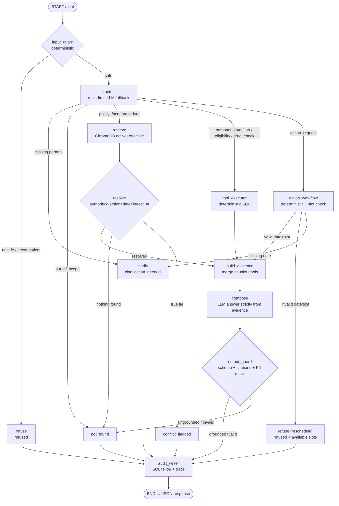

# ARCHITECTURE — AI-Powered Hospital Patient Services Assistant

## Tier 1: Fixed LangGraph — One Linear Graph, No Dynamic Planner

**Why Tier 1 (not Tier 2/3):** Every question type has a known, finite route. The statement's design
principle says "use the simplest architecture that satisfies the requirements". A fixed graph with
conditional edges covers all R1–R11 with deterministic routing and no agent overhead.
No supervisor agent is needed — the graph IS the supervisor.

## Graph Flow (mermaid)

## Component → Requirement Mapping
| Component | File | Req IDs |
|---|---|---|
| input_guard | app/graph/nodes.py | R7, R8 |
| router | app/graph/nodes.py | R9 |
| retrieve + resolve | app/graph/nodes.py | R1, R2, R4 |
| tool_executor | app/tools/hospital.py | R5 |
| action_workflow | app/tools/hospital.py, nodes.py | R5, R9 |
| build_evidence | app/graph/nodes.py | R6 |
| compose | app/llm/gateway.py | R3 |
| output_guard | app/llm/guard.py | R2, R3 |
| audit_writer | app/trace/store.py | R10 |
| /admin/ingest | app/api/main.py, app/rag/ | R11 |

## Why Not More Agents
- Appointment Agent, Insurance Agent, Lab Agent: all are single SQL queries → one `tool_executor` node
  with a dispatch table is simpler and has one test file instead of five
- Planner: intent classification is keyword-first (no LLM cost for obvious questions); LLM fallback only
  for ambiguous inputs
- Supervisor: not needed — all routes are known at design time

## Data Layer
- SQLite `data/hospital.db`: patients, appointments, insurance_policies, lab_results, drug_interactions,
  doctor_slots, pending_actions, audit_log
- ChromaDB `data/chroma/`: policy/procedure documents; metadata: doc, section, version, effective_date,
  authority, status (active/superseded), ingested_at

## LLM Gateway
- Groq main (llama-3.3-70b-versatile or similar) → Gemini flash fallback
- MOCK_LLM=true: canned deterministic responses; no network calls
- JSON structured output with one repair retry
